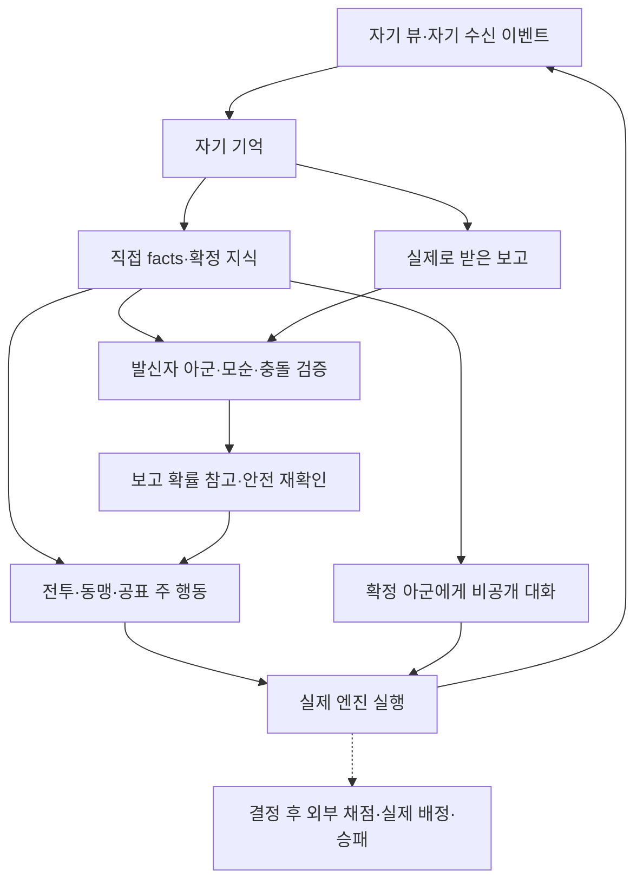

# AI 개선 022회차 — 누적 불변 자료 검증과 12시 최종 정리

**누적 검증 완료·12시 마감 처리 전·신규 연구실행0·새 개발/실험 없음.**021완료 `d79e67f59c9b43a98d4ad0a6a0c2d75957f01b97` 직후 이어갔다. 아래20개 주 원자료/각 불변 소스/독립 검증기/저널과 실제 경기 개수를 재검증했다. 누적31,296검증실행 중31,294경기는 종료,020의제한미종료2경기는0.5점으로포함했다. 과거 중단500/019미검증상한6은 별도 제외한다.021은후보65.885/main69.271%로미채택·기본OFF이며 독립121000미사용이다.

이번 회차는 기존001–021원자료의 각 불변 소스 대조·독립 검증 명령 재실행·중복 없는 시드 원장·실제 실행/제한 미종료/제외 자료·채택 판단·남은 문제를 정리한다. 새로운 시드/후보/정책/게임 실행을 만들지 않는다. 독립121000–121015와조건부129000/134000/136000은 미사용으로 잠근다.112000/116000과거최종은미채택보존·재튜닝/모드선택/승격재사용금지다.

유한 문서 검증 lease12:05이며 이는 실험 기간 연장이 아니다.11:50이후 신규실험금지·12시이후새개발없이최종보고/반복작업비활성화. main병합/운영배포/Supabase변경없음. 실제 검증 완료 뒤 원장/요약·재현 명령·코드/옵션 해시·결정·자료 링크를 추가하고 ACTIVE를 completed로 전환한다.

## 실제 실행 원장·판단

각 행의 점수는 해당 회차 안의 대응 비교다. 다른 시드/정책/진단 모집단의 점수를 합쳐 승률을 만들지 않는다.001은 황야/트롤만, 나머지는4모드이며015/019/020은 공개p1의 단일 개입 진단이지 전 봇 정책 성적이 아니다. 회차MD에모드별결과/재현/해시/실패상태가있다.

|회차|용도·사용 시드|검증 실행|판단|
|---|---|---:|---|
|001|경제 진단114000–114004|240|사용가능단계2/완성3구분·승격없음|
|002|개발115000–115004|1,200|보석/동맹예산미승격·중단500별도|
|003|개발117000–117004|1,200|아군요청접근미채택|
|004|개발118000–118004|1,200|정보교환선별접근미채택|
|005|개발119000–119004|1,200|지휘관성장후보고정|
|006|독립116000–116015|2,304|main71.61→후보69.14%·미채택최종보존|
|007|개발120000–120004|720|보고최상급공격68.33→68.75/main72.50%·미채택|
|008|개발122000–122004|720|부분보석보류69.58→69.17/main71.67%·미채택|
|009|진단123000–123004|720|보류뒤대기진단·정책승격없음|
|010|개발124000–124004|960|다른행동있을때보석보류68.33→67.92/main68.75%·미채택|
|011|07시 당시 마감|0|기존자료검증·이후 사용자재개지시로대체|
|012|개발125000–125004|720|보고일반순서66.25→69.17/main70.83%·미채택|
|013|진단126000–126004|720|재확인감소의다른대상보석재배분확인|
|014|개발127000–127004|960|보고대기fallback69.58→67.92/main72.08%·미채택|
|015|대응학습128000–128031|3,072|가명공표한번진명8셀모두후보없음|
|016|개발130000–130007|1,152|진명한턴유지67.71→66.93/main71.88%·미채택|
|017|개발131000–131007|1,152|대기재공표67.19→68.23/main69.79%·미채택|
|018|개발132000–132007|1,152|다음턴공격예산69.01→69.01/main70.31%·미채택|
|019|대응학습133000–133063|6,144|동맹한번지연67.0573→66.9922%·4셀후보없음|
|020|대응진단135000–135047|4,608|재확인한번일반66.5582→66.5148%·후보없음·미종료2|
|021|개발137000–137007|1,152|사망아군보고확인65.625→65.885/main69.271%·미채택|
|022|누적불변검증·마감|0|주원자료20개·시드중복없음·운영승격0|
|합계|001–021의주원자료만|31,296|진행중연구경기0·독립121000미사용|

112000–112015의과거최종1,536실행(70.83→68.23%)과113000의이전분리진단768실행, 그 이전 연구는 이 합계에 포함하지 않는다.116000은006의주자료로한번만세며재검증을재실행경기로세지않는다. 단위검사의시뮬레이션/체크포인트/저장장애원본/복구겹침도중복합산하지않는다.

|예약·보호 구간|최종 상태|
|---|---|
|121000–121015|독립16시드 미사용·개발미달후보에소비하지않음|
|129000–129007|015행동변경후보없음·미사용|
|134000–134007|019후보없음·미사용|
|136000–136007|020후보없음·미사용|
|112000–112015|미채택최종보존·재튜닝/모드선택/승격재사용금지|
|116000–116015|006미채택최종보존·무결성읽기검증만·재튜닝/모드선택/승격재사용금지|

## 최종 검증·재현·해시

최신 정책 소스 `8eb4e065b0fae7ed90d4b503bd6e4226954998c6`:584테스트(rules516/server68)·정보은닉·타입·서버/클라이언트/Worker빌드 통과. [CI38672201335](https://github.com/Cjsarts0509/Guardian-Spirits-Tactics/actions/runs/38672201335)와 [브라우저38672201357](https://github.com/Cjsarts0509/Guardian-Spirits-Tactics/actions/runs/38672201357) 성공.021이후 정책변경/신규연구경기0이다.022의새코드는원자료읽기검증기뿐이며주자료를변경하지않는다.

`tools/audit-cooperative-corpus.py`는 원장에 적힌 압축SHA·불변소스·각 독립검증명령의성공·전체경기개수·제한미종료·주자료시드범위비중복·미사용예약비침범을 확인한다.20개모두성공·31,296실행·미종료2·예약침범0이었다. 중복원장을추가한별도음성검사는실패하고완료출력파일을만들지않음을확인했다. 기존경기를다시시뮬레이션하거나정책/모드/셀을선택하지않는다.

```sh
python tools/audit-cooperative-corpus.py docs/evaluations/cooperation-corpus-manifest.json --out /tmp/gst-corpus-audit.json
cmp /tmp/gst-corpus-audit.json docs/evaluations/cooperation-round-022-corpus-audit.json
```

|SHA256 대상|해시|
|---|---|
|최신bot.ts|ae93104627c2091185c06c139e48f734e213b52eed7036d760015b8bbacf86ab|
|최신bot-intel.ts|b42dc044a27b7ed8fc2c2578587ac4b431d957b9e25dd0c800547a1875d1e897|
|기본정책 옵션 `{}`|44136fa355b3678a1146ad16f7e8649e94fb4fc21fe77e8310c060f61caaff8a|
|audit-cooperative-corpus.py|e0eec310f6431032263a3631692c8b107dbe94e71d8f88a133815e7949f87ed4|
|cooperation-corpus-manifest.json|6884edc5222e76a21562a6be7d9442459d5e78378c3aedb14bfed1a4f48c7ba1|
|cooperation-round-022-corpus-audit.json|9fbba5dfccc7a3f0b1a9e274c07b8911165ecbac97595bad839ef23415804f53|

각회차옵션/모든평가소스/원자료·저널SHA/실제독립검증명령은 [전체 원장](../evaluations/cooperation-corpus-manifest.json)과 [검증 원자료](../evaluations/cooperation-round-022-corpus-audit.json)에보존했다. 불변source-ref를사용하므로과거자료를최신정책성적으로오인하지않는다. 스냅샷/저널불일치019·020의원본과무수정복구계보는각회차에있다.021에서는불일치없음/신규0재개동일을확인했지만원인을해결했다고단정하지않는다.

## 사용자 요구와 정보 경계



보고에서직접facts로가는경로는없다. 확정아군동맹/확정적동맹파기/실제비공개보고/위장접근경계/상황별공표는기존PR후보에남아있다. 대화는활동판단에딸린별도경로여서주행동을대체하지않는다. 자기정보로만판단하고실제배정/다른봇기억을의사결정에넣지않는다.021의사망아군보고옵션도기본OFF이며일반추론·직접facts·보고공격·재전파에추가하지않는다.

## 채택·미완료·후속 조건

운영승격0·PR16초안유지. 단순마나/보너스/보석완성/보고량/대기감소를승률근거로대체하지않았다. 동맹지출이줄어도협력지연/다른행동/생존변화가발생했고, 보고대상확인비용감소는다른대상보석재배분을포함했다. 진명보너스증가도노출/전투기회손실을넘는승리이득으로입증되지않았다.

남은문제는전체승리개선미입증,황야·트롤의정보·협력·노출·보석·전투가치를일관되게판단하는정책부재,저장불일치원인미확정,인간상대/현재운영버전미검증이다.020미종료2경기를성공종료로바꾸지않았고독립121000은미실행이다. 운영서버/Supabase를검증하거나변경하지않았다.

후속은추가사용자지시가있을때만새개발시드를예약하고기존최종은잠근채진행한다. 개발후보>control·후보>=main·안전0→불변고정→새독립전체차이시드95%하한>0·각모드>=−2%p·안전0이필수다. 현재자료로모드/셀/문턱을재선택하지않는다. 새실험자동재개없음. 최종마감상태/반복작업종료는12시확인후기록한다.
